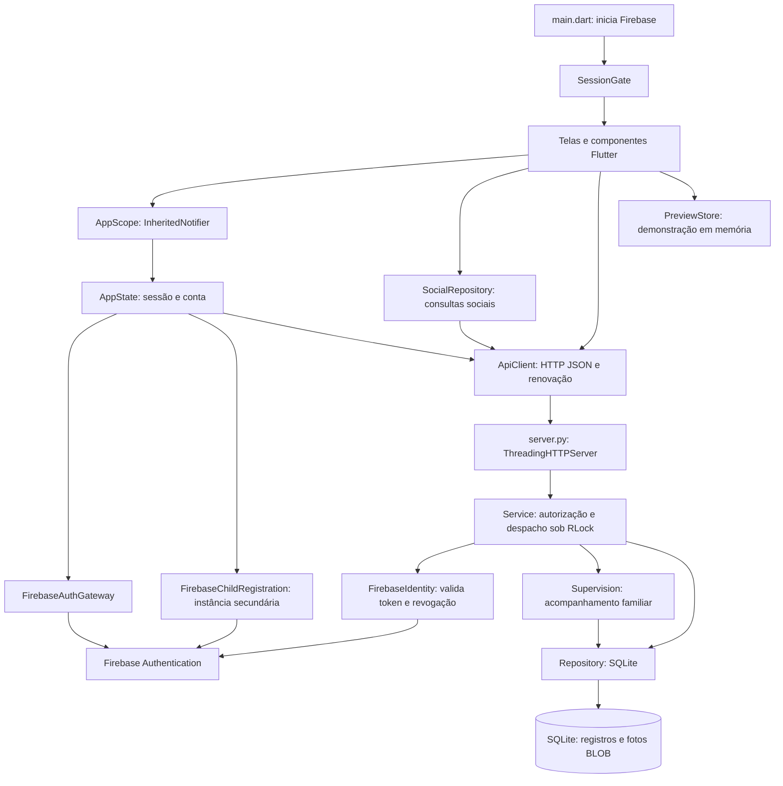
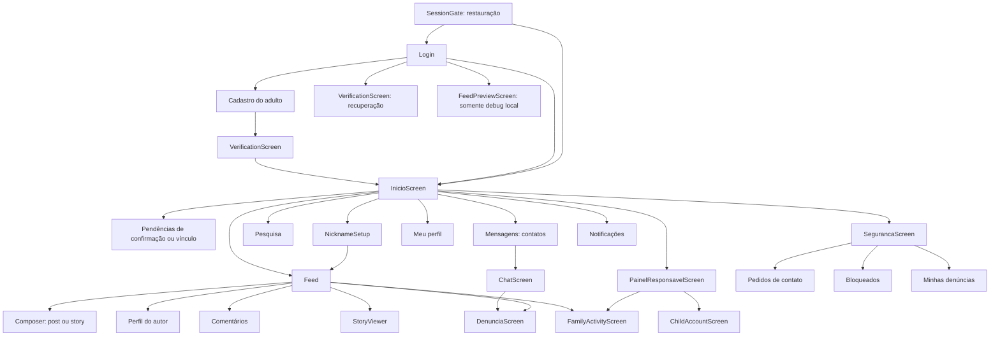

# Conexia — auditoria de arquitetura, regras de negócio e UX/UI

**Data:** 08/10/2026  
**Projeto analisado:** `C:\Users\Pc\Downloads\teste\teste_app`  
**Entrega:** diagnóstico e plano de ação anterior às alterações de código.  
**Estado:** correções propostas; nenhuma correção de aplicação implementada nesta auditoria.

## 1. Parecer técnico e escopo

A Conexia possui um MVP integrado, com persistência real, autenticação Firebase, vínculo familiar e componentes sociais reutilizáveis. A arquitetura atende à demonstração local. As principais fragilidades estão na autorização de contatos envolvendo menores, consistência do chat/paginação, custo do feed e sincronização entre sessão, telas e operações assíncronas.

O primeiro ciclo deve corrigir essas fragilidades antes de ampliar o produto com escola, tutores, gamificação ou novas mídias. Não é necessário reescrever o aplicativo nem trocar o SQLite para iniciar as correções. As fotos permanecem no banco, conforme o requisito do projeto.

A revisão abrangeu a estrutura de arquivos, módulos Dart em `lib`, API e scripts Python em `backend`, testes, documentação, dependências e configuração das plataformas. Artefatos gerados, caches, binários e banco local foram tratados como infraestrutura/dados, não como código autoral. Credenciais privadas não foram abertas. O inventário acompanha o relatório.

Foram executados testes existentes e cenários adicionais exclusivamente com dados fictícios em bancos SQLite em memória. Nenhuma conta real foi criada, nenhuma mensagem/e-mail foi enviada e nenhum dado do banco em uso foi alterado. Há alterações anteriores não commitadas no repositório; elas foram preservadas. A análise de UX foi feita a partir da implementação das telas e dos testes de widgets; não houve estudo de usabilidade com pessoas, ensaio em dispositivo móvel ou perfil de desempenho de uma sessão real de navegador.

**Classificação:** P0 = bloqueia o fluxo seguro do produto; P1 = corrigir antes do piloto; P2 = melhoria posterior. “Reproduzido” significa execução isolada que confirmou o comportamento. “Inspeção” significa evidência no código, sem medição de impacto em uso real. “Lacuna” identifica um recurso ainda ausente, sem confundi-lo com um defeito implementado.

## 2. Arquitetura atual

| Camada | Implementação | Avaliação |
|---|---|---|
| Interface | `screens`, `widgets`, `theme` | Componentes sociais compartilhados; telas ainda concentram chamadas, estado e regras de apresentação. |
| Estado global | `AppState` + `AppScope` | Adequado como base; falta máquina explícita de sessão e invalidação dos dados por conta. |
| Estado das funcionalidades | `StatefulWidget`, `setState`, `FutureBuilder` | Feed, chat e família mantêm estados independentes e parcialmente desconectados. |
| Integração | `ApiClient`, `SocialRepository`, gateways Firebase | HTTP centralizado; operações de escrita ainda são disparadas diretamente pelas telas. |
| Domínio | `Service._dispatch`, `Supervision`, `security` | Autorização no servidor; o despachante concentra muitos assuntos diferentes. |
| Persistência | Uma conexão SQLite, `Repository.execute` com commit por chamada | Funcional em desenvolvimento; falta evolução versionada de esquema, índices e unidades de trabalho. |
| Operação | `maintenance.py`, `moderate.py`, servidor local | Ferramentas úteis para desenvolvimento; ausência de operação de piloto e implantação. |

**Pontos que devem ser preservados:** validação de identidade no servidor, bloqueio bidirecional, verificação de propriedade da mídia, separação entre nome interno e apelido, transação de postagem/carrossel, rejeição de HTTP remoto no cliente e prévia isolada de dados reais. SQLite usa chaves estrangeiras, e as senhas locais usam hash com salt; isso não significa criptografia do arquivo de banco.

## 3. Navegação real entre telas

A navegação combina sete rotas nomeadas em `main.dart` com rotas imperativas `MaterialPageRoute`. O guard das rotas nomeadas verifica a existência de `account` ao construir a rota; as condições de acesso social são apresentadas em `InicioScreen` e aplicadas novamente na API. Esse guard não é uma política reativa uniforme para todas as telas empilhadas.

O aplicativo autenticado tem **quatro abas**: Feed, Pesquisa, Mensagens e Perfil; criar uma publicação é uma ação dentro do feed. A prévia tem **cinco abas**, incluindo Criar. Na prévia, `IndexedStack` preserva as telas; no aplicativo autenticado, `AnimatedSwitcher` com `KeyedSubtree` troca e descarta as telas. A diferença faz a experiência de demonstração preservar dados que se perdem na navegação real.

## 4. Gerenciamento de estado

`AppState` mantém a conta, token HTTP, carregamento inicial, erro e operações de login/cadastro/renovação/logout. O gateway Firebase mantém a identidade no SDK. No modo legado, o refresh token usa secure storage em plataformas nativas e memória na web. Na autenticação Firebase, a persistência é gerenciada pelo SDK, portanto a descrição antiga de “sessão web apenas em memória” não representa esse fluxo.

`AppScope.of` estabelece dependência do `InheritedNotifier`: `notifyListeners` pode reconstruir consumidores mesmo quando a alteração não afeta aquela tela. Isso não exige imediatamente outra biblioteca; o primeiro ajuste deve separar os estados por responsabilidade e reduzir dependências desnecessárias.

O feed guarda posts, stories, cursor e carregamentos na própria tela. O chat guarda mensagens e usa polling de oito segundos. As telas de família usam `FutureBuilder` ou `AsyncItems`. A prévia usa `PreviewStore`, compartilhando posts, comentários e curtidas entre abas. Salvar publicação fica apenas em um booleano do cartão; nem sequer é uma coleção global da sessão.

Há proteção contra renovação simultânea via `_refreshing`, mas não há observador central das mudanças de identidade Firebase nem controle de geração da sessão para ignorar respostas antigas. A conta local só se atualiza por determinadas operações explícitas.

## 5. Falhas e plano de correção por achado

### A01 — P0: aprovação de contato do menor pode contornar o responsável — reproduzido

**Evidência:** `backend/service.py:288` e `:294`. A restrição de idade considera o usuário que aprova, não os dois participantes. Um menor solicita contato a um adulto; o próprio adulto aceita e a API cria o vínculo aprovado nos dois sentidos. Reproduzido com um adulto diferente do responsável vinculado. Assim, não é apenas “falta do painel”: já existe um caminho que concede contato sem consentimento desse responsável.

**Correção planejada:** enquanto o fluxo parental não existir, impedir aprovação final de toda conexão com pelo menos um menor. Depois implementar solicitação, aceitação do destinatário e consentimento do responsável de cada menor envolvido. Somente ao concluir os consentimentos gerar permissões de visibilidade/mensagens. O responsável só decide sobre o próprio menor. Evitar usar o contato aprovado como mecanismo inicial de descoberta: adotar convite privado ou identificador temporário, sem diretório aberto de menores.

**Aceite:** menor→adulto, adulto→menor e menor→menor permanecem pendentes sem os consentimentos exigidos; outro adulto não aprova em nome da família; pausa e bloqueio prevalecem sobre qualquer consentimento.

### A02 — P1: chat esconde mensagens novas e marca conteúdo não entregue como lido — reproduzido

**Evidência:** `backend/service.py:379`. A consulta ordena em ordem crescente e limita às primeiras 200 mensagens. Com 201 registros, retornou até `m199`, omitiu `m200` e marcou as 201 como lidas.

**Correção planejada:** retornar a janela mais recente com cursor estável para carregar o histórico; separar confirmação de leitura da consulta e confirmar somente mensagens efetivamente apresentadas ao destinatário. Atualizar o chat incrementalmente, com carregamento inicial, erro, envio e rolagem até o final.

**Aceite:** conversa com mais de 200 mensagens mostra a mais recente, recupera todo o histórico sem duplicidade e não marca mensagens ausentes como lidas.

### A03 — P1: cursor do feed perde posts com o mesmo horário — reproduzido

**Evidência:** `backend/service.py:337` e `lib/repositories/social_repository.dart:7`. O cursor contém só `created` e a página seguinte usa `<`. Três posts com o mesmo horário: primeira página retornou dois, segunda retornou zero. A ordenação também não desempata por ID. A falha apareceu em testes com um runtime alternativo e foi confirmada com dados determinísticos.

**Correção planejada:** ordenar por `(created, id)` e emitir cursor composto; filtrar por ambos os valores. Atualizar o contrato da API e os modelos Dart juntos. Rejeitar cursores inválidos e valores não finitos.

**Aceite:** todos os registros com horários iguais são recuperados exatamente uma vez; inserções entre páginas não geram omissões de itens antigos.

### A04 — P1: feed varre o histórico inteiro antes de paginar — medido

**Evidência:** `backend/service.py:339`. Não há limite SQL na seleção inicial. O código verifica visibilidade post a post e carrega autor, avatar, likes e galeria com consultas adicionais. `backend/repository.py` não define índices específicos para essas consultas.

| Posts no banco | Posts retornados | Comandos SQL observados | Tempo local aproximado |
|---:|---:|---:|---:|
| 100 | 15 | 292 | 1,39 ms |
| 1.000 | 15 | 2.092 | 10,60 ms |
| 5.000 | 15 | 10.092 | 53,91 ms |

O ensaio foi em memória, com um autor adulto e sem Firebase/rede. É evidência do crescimento das consultas, não previsão de latência em produção.

**Correção planejada:** buscar candidatos em lotes limitados, aplicar filtros de autorização antes de fechar a página e agregar galerias/contagens/autores em consultas de lote. Criar índices justificados por planos de consulta. Manter verificação atual de bloqueios, vínculos e privacidade; não otimizar retirando regras.

**Aceite:** carregar 15 posts deixa de consultar cada post antigo; registrar número de consultas, linhas examinadas e p95 num conjunto com perfis públicos, privados, bloqueados e menores. O limite escolhido não pode truncar resultados autorizados por filtrar depois da paginação.

### A05 — P1: toda a API fica serializada, inclusive verificações externas — inspeção

**Evidência:** `backend/service.py:94`, `backend/firebase_identity.py:17` e `:26`. O servidor recebe requisições em threads, mas um `RLock` envolve o despacho completo. Dentro dele ocorrem validação Firebase, consulta do responsável, SQL, commits e codificação de imagens. Uma operação demorada pode bloquear as demais. O cache do responsável só dura uma requisição; também há atualização de `verified` com commit nas chamadas autenticadas.

**Correção planejada:** definir primeiro conexões por requisição e transações; então reduzir a região crítica e remover I/O externo de um lock global. Avaliar um servidor/framework apropriado à implantação. Não remover o lock mantendo a mesma conexão compartilhada, nem desativar verificação de revogação para ganhar velocidade.

**Aceite:** uma verificação de identidade lenta não paralisa requisições independentes; nenhuma transação fica misturada entre usuários. Testar pausa/revogação e concorrência real.

### A06 — P1: limitador perde janelas longas e prejudica IP compartilhado — reproduzido/inspeção

**Evidência:** `backend/service.py:20`. Cada chamada limpa o dicionário usando sua própria janela. O limite de login de 900 segundos é apagado por uma chamada de janela de 60 segundos. Após oito tentativas, uma chamada aos 61 segundos permitiu nova tentativa, embora ainda dentro dos 900 segundos. Além disso, o limite de 180 requisições/minuto/IP reúne família, imagens, visualizações e chat, o que pode afetar uma escola com saída de rede compartilhada. Reiniciar o processo também zera os contadores.

**Correção planejada:** armazenar expiração por chave; separar identidade, ação e IP; usar armazenamento compartilhado quando houver mais de um processo. Tratar leitura, upload e tentativas de autenticação com políticas próprias.

**Aceite:** janela de 900 segundos resiste a chamadas de outras políticas; ensaio com vários usuários no mesmo IP não bloqueia navegação legítima indiscriminadamente.

### A07 — P1: imagens são aceitas sem decodificação válida — reproduzido

**Evidência:** `backend/service.py:302`. Apenas MIME, tamanho e cabeçalho são conferidos. Bytes com assinatura PNG e texto inválido foram aceitos como mídia. Não há limite de dimensões/pixels nem remoção de metadados.

**Correção planejada:** decodificar no servidor, validar dimensões e formato, rejeitar arquivos truncados e recodificar sem metadados antes de persistir. Gerar variantes menores para feed/avatar dentro do próprio banco. Adotar limites por conta e conteúdo. O processo deve manter as fotos no banco.

**Aceite:** imagens inválidas e com dimensões excessivas são rejeitadas; arquivos válidos continuam exibidos; geolocalização/metadados não seguem para outros usuários; variantes respeitam autorização.

### A08 — P1: transporte e reconstrução de imagens aumentam memória e tráfego — inspeção

**Evidência:** mídia passa em base64 dentro de JSON; `PrivateImage` decodifica em `build`, `ProfileAvatar` cria `MemoryImage` novamente e não há cache de bytes compartilhado por mídia/sessão. Base64 aumenta o payload em aproximadamente um terço. Carrosséis e avatares podem solicitar o mesmo arquivo repetidas vezes. O servidor usa `no-store`, uma proteção que deve ser preservada no desenho de dados privados.

**Correção planejada:** oferecer endpoint binário autenticado, variantes adequadas ao tamanho exibido e cache limitado em memória por sessão/permissão. Invalidar ao sair, bloquear ou mudar de conta. Evitar cache persistente de conteúdo privado sem política específica. Decodificar uma vez por recurso e adequar resolução de decodificação.

**Aceite:** medir bytes, requisições repetidas e memória num feed com várias fotos; dados de uma conta não reaparecem em outra; revogação continua bloqueando novas leituras.

### A09 — P1: trocar de aba descarta feed e pesquisa — inspeção

**Evidência:** `lib/screens/inicio_screen.dart:134`. `AnimatedSwitcher` com chave por índice descarta a tela anterior após a transição. Voltar ao feed reinicia consultas, cursor e posição; salvar em cartão também se perde. A prévia preserva telas via `IndexedStack`.

**Correção planejada:** manter estado das funcionalidades independentemente do widget e preservar as abas carregadas sob demanda. Não montar todas com polling ativo; suspender timers e acompanhamento em abas invisíveis. Separar a ação Criar da seleção de abas de forma consistente entre prévia e fluxo real.

**Aceite:** Feed→Pesquisa→Feed mantém posição/páginas; não registra visualização em aba oculta; não inicia chamadas desnecessárias para abas nunca abertas.

### A10 — P1: curtida recarrega o feed inteiro e requisições podem competir — inspeção

**Evidência:** `lib/screens/social/feed_screen.dart:80`, `:124` e `:280`. Curtir chama `load`, entra em carregamento de tela e consulta posts/stories novamente; feed e stories são consultados em sequência. Não há geração da consulta nem proteção geral contra uma carga antiga substituir uma nova. Duplo toque pode acionar toggle mais de uma vez antes da atualização. Um erro ao carregar mais substitui a lista por estado de erro integral.

**Correção planejada:** operação de curtida idempotente com estado desejado, atualização local por post e rollback em falha; controle de operação por item; identificar a consulta atual, ignorar respostas antigas e deduplicar IDs. Preservar posts em erros de paginação. Consultar stories separadamente e só quando necessário.

**Aceite:** curtidas rápidas não invertem o resultado final; a segunda página não apaga a primeira; falha de stories não elimina posts já disponíveis.

### A11 — P1: sessão e autorização exibida podem ficar desatualizadas — inspeção

**Evidência:** `AppState`, `SessionGate`, `main.dart:64`. Não há assinatura central de eventos de identidade; falha definitiva da renovação Firebase retorna `false` sem limpar `account`. Pausa do responsável pode deixar a UI mostrando conteúdo carregado e ações ativas até uma nova consulta. A API bloqueia novas operações, mas a interface não converge automaticamente ao estado de pendência. Rotas empilhadas não usam um guard uniforme.

**Correção planejada:** modelar estados de sessão: iniciando, autenticada com pendências, autorizada, indisponível por conexão e encerrada. Observar identidade/token, distinguir 401 definitivo de 503/rede, revisar acesso ao retomar o app e invalidar estados sociais por geração de sessão. Centralizar a decisão de navegação e limpar telas ao trocar de conta.

**Aceite:** token revogado leva ao login; falta temporária de rede não apaga a conta arbitrariamente; pausa leva à tela correta; resposta iniciada na conta A não alimenta a conta B.

### A12 — P1: sair depende de rede e logout revoga todos os dispositivos — inspeção

**Evidência:** `lib/state/app_state.dart:177`, `backend/service.py:165`. Se a API estiver indisponível, `logout` não executa `clearSession`. No Firebase, a operação revoga refresh tokens da identidade inteira, não apenas o dispositivo atual.

**Correção planejada:** limpar sessão local mesmo quando a revogação remota falhar, informando essa diferença; distinguir Sair deste dispositivo de Encerrar todas as sessões. A interface não deve afirmar que houve revogação global quando ela falhou.

**Aceite:** dispositivo compartilhado sai da conta sem rede e não mostra dados antigos; logout simples não invalida outros dispositivos sem ação explícita.

### A13 — P1: busca limita candidatos antes de conferir permissões — reproduzido

**Evidência:** `backend/service.py:281`. `LIKE ... LIMIT 50` vem antes de `visible`. Com 50 perfis privados e um público compatível, a API retornou zero, apesar de haver um resultado permitido. Não é vazamento do perfil privado; é perda de resultados.

**Correção planejada:** paginação estável de candidatos/consulta autorizada, preservando a proteção de menores. Na UI, abrir perfil pelo resultado, indicar pedido pendente/aprovado e impedir pedidos duplicados. O `INSERT OR IGNORE` atual ainda cria notificação em tentativas repetidas.

**Aceite:** perfis permitidos não desaparecem por causa de candidatos invisíveis; não há diretório aberto de menores nem spam de notificações por repetição.

### A14 — P1: API aceita story como visualização do feed — reproduzido

**Evidência:** `backend/supervision.py:30`. O registro chama `post`, mas não rejeita `story=1`. Um ID de story enviado a `/posts/:id/view` foi persistido em `feed_views`, contrariando a documentação de acompanhamento apenas do feed. O cliente normal não faz isso, mas o servidor deve aplicar a regra.

**Correção planejada:** rejeitar stories nas rotas de acompanhamento/temas conforme a política definida e manter o contrato explícito. O tempo informado pelo cliente continua sendo evidência de exibição declarada, não prova de atenção.

**Aceite:** tentativa de registrar story não cria histórico nem categoria; testes cobrem chamadas diretas à API.

### A15 — P1: cadastro/exclusão entre Firebase e SQLite precisa de reconciliação — inspeção

**Evidência:** `AppState.register`, `child_registration.dart` e `backend/service.py:183`. O cadastro do menor já tenta limpar a identidade criada se o vínculo falhar, e o adulto pode retomar cadastro. Ainda assim, os dois sistemas não compartilham transação. Na exclusão, Firebase é apagado antes de SQLite; uma falha local posterior pode deixar perfil sem identidade acessível para repetir a ação. O cleanup do cadastro também pode ocorrer após resposta perdida embora o servidor tenha confirmado o vínculo.

**Correção planejada:** operações idempotentes com ID de operação, estados pendentes e reconciliação. Na exclusão, bloquear o acesso primeiro, persistir a intenção e completar a remoção com repetição segura. Testar respostas perdidas, falha de commit, indisponibilidade Firebase e limpeza incompleta.

**Aceite:** repetir cadastro/exclusão resolve a mesma operação sem duplicar usuários nem deixar conteúdo social de perfil órfão disponível.

### A16 — P1: exportação de dados está incompleta — inspeção

**Evidência:** `backend/service.py:179`. Exporta perfil, posts, comentários, denúncias, bloqueios e mensagens, mas não inclui integralmente vínculo familiar, acompanhamento, temas de conversa, galerias, imagens e contatos. A UI exibe JSON para copiar; não oferece um arquivo completo.

**Correção planejada:** especificar o conteúdo por papel e propriedade, incluir as relações pertinentes e entregar exportação utilizável. Dados de terceiros não devem ser incluídos indiscriminadamente. Testar integridade sem afirmar conformidade jurídica automática.

**Aceite:** matriz de tabelas/campos mostra inclusão ou exclusão justificada; exportação contém as imagens e relações próprias previstas; responsáveis e menores não recebem dados fora das permissões.

### A17 — P1: manutenção de mídias exige parar a API — lacuna operacional

**Evidência:** `maintenance.py:17` e upload em etapas no composer. Mídias ficam sem referência antes da publicação. Se a manutenção executar nesse intervalo, apaga uploads válidos. O script avisa para parar a API, mas não impõe exclusão mútua com ela. Falhas de postagem deixam órfãos até limpeza; sem quotas, o banco pode crescer.

**Correção planejada:** introduzir estado de upload, data de criação, prazo de expiração para pendências e publicação que finalize a associação. Coleta periódica deve considerar o prazo e a transação; não apagar toda mídia sem referência imediata. Acrescentar quotas e monitoramento do tamanho do banco.

**Aceite:** upload/publicação simultâneos à manutenção preservam mídia válida; pendências antigas são removidas; reenvio não duplica galerias por resposta perdida.

### A18 — P1: persistência e domínio concentram operações sem fronteiras claras — inspeção

**Evidência:** `Repository.execute` confirma cada comando; `Service._dispatch` combina autenticação, contatos, publicações, mídia e mensagens. Algumas operações já têm transação, mas aprovação de contatos, decisões de moderação e outras sequências não são unidades atômicas explícitas.

**Correção planejada:** extrair serviços por domínio gradualmente, mantendo um ponto de entrada estável; criar unidade de trabalho para mudanças correlacionadas, migrações versionadas e índices. Separar autorização compartilhada de serialização e consulta. Não realizar uma migração de banco e uma reescrita completa na mesma etapa.

**Aceite:** falha na segunda escrita não deixa aprovação unilateral ou decisão parcialmente aplicada; uma instalação antiga migra sem apagar dados.

### A19 — P1: fluxo real de dois e-mails e retomada não está coberto ponta a ponta — lacuna

Os testes atuais usam gateways/provedores simulados em parte do fluxo. Confirmar um e-mail não comprova idade ou parentesco. O formulário cria contas familiares em duas etapas e solicita senha do menor ao responsável; um convite com conclusão pelo próprio participante é uma evolução possível, mas requer especificação.

**Correção planejada:** executar roteiro com dois e-mails de teste, troca de dispositivo, confirmação tardia, retomada de cadastro, recuperação e pausa. Registrar consentimento com versão de texto/finalidade e definir recuperação de vínculo e transição aos 18 anos. A estrutura atual aceita um responsável por menor; múltiplos responsáveis ou transferência ainda não existem.

**Aceite:** roteiro repetível sem intervenção no banco; menor sem vínculo não entra no feed; uma troca de responsável tem autorização e histórico definidos.

### A20 — P1: moderação e recursos escolares ainda não formam uma operação de piloto — lacuna

Denúncias persistem e existe CLI para posts/comentários. Não existe painel autenticado de operadores, fila com atribuição/escalonamento, tratamento completo de perfil/conversa nem política de acesso pedagógico. Não há instituição, turma, tutor ou atividade educativa implementada. Categorias são escolhidas pelo autor, portanto não devem ser apresentadas como avaliação automática de adequação.

**Correção planejada:** definir papéis, responsabilidades e fluxo de atendimento antes de introduzir tutores; limitar o acesso do tutor a suas atividades/turmas. Manter o histórico familiar e mensagens privadas fora de acesso automático do tutor. Especificar moderação humana e classificação do conteúdo sem promessa de proteção infalível.

**Aceite:** cada denúncia tem responsável e decisão auditável; tutor não consulta turma alheia nem histórico familiar; atividades escolares são testadas como módulo próprio.

### A21 — P2: renderização e timers precisam acompanhar apenas itens necessários — inspeção

O feed, listas genéricas e chat criam listas de widgets a partir de todo o conjunto carregado. O carrossel já usa builder, mas há trabalho antecipado de construção no restante. `PostExposure` usa um timer por cartão, a cada 250 ms, que continua disparando mesmo após registrar a exibição. Polling do chat verifica rota, mas não verifica explicitamente o ciclo de vida em primeiro plano.

**Correção planejada:** listas com construção sob demanda, controle central/lazy de exposição, encerramento do timer após sucesso e suspensão do polling ao sair do primeiro plano. Ao preservar abas, testar também invisibilidade delas; `IndexedStack` sozinho não define essa política.

**Aceite:** perfil de CPU/memória com feed longo; nenhum evento de exposição em aba oculta ou aplicação suspensa; nenhum polling desnecessário em segundo plano.

### A22 — P2: ajustes de UX e acessibilidade verificáveis — inspeção/hipóteses de teste

O visual social já tem avatares, carrossel, ícones e confirmação de ações destrutivas. Os próximos ajustes devem tratar inconsistências concretas:

- Meu perfil, perfil do autor e painel familiar usam cabeçalhos fixos acima de listas expandidas; avaliar overflow em tela pequena/teclado/texto ampliado e converter para rolagem unificada se necessário.
- O avatar de story remoto não usa `authorAvatar`; aparece inicial mesmo quando o perfil tem foto. Usar o mesmo componente de avatar das postagens.
- O composer aceita várias fotos em story, mas `StoryViewer` exibe apenas `photos.first`; restringir a uma foto ou implementar a sequência completa.
- `PostPhotoView` pede `BoxFit.contain` no story remoto, mas `PrivateImage` usa sempre `cover`; passar o parâmetro até o componente final.
- `PrivateImage` não atualiza o Future ao mudar `media`/endpoint; chaves atuais reduzem alguns casos, porém é necessária invalidação explícita por recurso e sessão.
- “Salvar nesta sessão” fica no cartão e se perde ao desmontá-lo; centralizar coleção por sessão ou implementar favoritos persistentes como entrega independente.
- Exportação mostra JSON cru, compartilhamento mostra ID, e notificações são apenas texto; oferecer ações úteis e destinos claros.
- Textos pequenos/cinzentos, story de altura fixa, alvos de avatar e nome com `GestureDetector` exigem revisão com teclado e leitor de tela. Não há evidência de certificação de acessibilidade.

**Aceite:** roteiro em 360×640, tela ampla e texto ampliado; foco/semântica/contraste verificados; nenhum corte; ação sempre apresenta retorno e conserva contexto. Esses problemas de layout são riscos identificados por código, ainda sem ensaio visual completo.

### A23 — P2: callbacks assíncronos precisam respeitar descarte e sessão — inspeção

**Evidência:** `messages_screen.dart:115` limpa `TextEditingController` após o await antes de verificar `mounted`. Se a tela for fechada durante envio, o controller pode já estar descartado. A troca de conta também requer descartar respostas antigas, e helpers com Future único não reagem automaticamente a parâmetros novos.

**Correção planejada:** verificar tela/sessão antes de tocar controllers ou estado; cancelar/ignorar operações obsoletas; atualizar `AsyncItems` quando o identificador de consulta mudar. Não depender somente de keys espalhadas.

**Aceite:** fechar chat durante envio e alternar sessão durante consulta não causa erro de widget nem mistura de dados.

### A24 — P1 para implantação: ambiente, documentação e entrega reproduzível — inspeção

O servidor exige `CONEXIA_DEV=1` e mantém autenticação local com códigos de desenvolvimento mesmo com Firebase configurado. Isso é aceitável no host local atual, mas não deve ser o caminho de exposição pública. O README ainda contém instruções legadas que não configuram Firebase e declara sessão web sem persistência, enquanto `docs/FIREBASE.md` descreve a configuração atual. Android mantém application ID de exemplo e assinatura release com chave debug; web ainda mostra `teste_app`. Linux lança `UnsupportedError` na configuração Firebase. A existência de pastas de plataforma não prova que todas estão prontas.

**Correção planejada:** configuração explícita de modos, autenticação legada isolada em teste, inicialização com falhas claras, ambientes de teste separados e dependências Python reproduzíveis em ambiente virtual. Consolidar o README, revisar plataformas suportadas, assinatura e identidade visual. Preparar build release e ensaiar em dispositivos antes de distribuir. Não publicar durante esta auditoria.

**Aceite:** instruções funcionam numa máquina limpa; modo de implantação não retorna códigos locais; build identifica Conexia e usa assinatura/configuração apropriadas; restauração de backup é demonstrada.

## 6. Evidências da validação atual

| Verificação | Resultado em 08/10/2026 |
|---|---|
| `python -m unittest discover -s backend -v` | **46 aprovados**, Python 3.14 do sistema, Firebase Admin 7.7.0 disponível. |
| `flutter test --reporter expanded` | **17 aprovados**. |
| `flutter analyze` | Sem problemas reportados. |
| `git diff --check` | Sem erros de whitespace; avisos de conversão LF/CRLF. |
| Cenários isolados extras | Confirmaram A01, A02, A03, A06, A07, A13 e A14. |
| Medição do feed | Confirmou crescimento de consultas em A04. |

A primeira execução com o Python empacotado do ambiente tinha três erros por ausência de `firebase_admin` e três falhas relacionadas à ordenação/horários. A execução no Python do projeto passou integralmente. A ausência da dependência naquele runtime não é defeito da aplicação; os horários iguais, porém, foram reproduzidos de maneira determinística e precisam de correção. Não apresentar apenas a execução bem-sucedida como prova de ausência de falhas.

Os testes atuais são uma boa base, mas não cobrem as reproduções acima nem concorrência, rede real Firebase, grandes históricos, multiusuário no mesmo IP e navegação real completa. Nesta etapa não foi feito novo build release, teste Android/iOS, ensaio de segurança ofensivo ou medição de FPS em dispositivo.

## 7. Plano de ação aplicado ao planejamento

O plano abaixo organiza a implementação; “planejado” não significa corrigido. Cada lote deve gerar mudanças pequenas, testes de regressão e evidência de aceite antes do lote seguinte. Nenhuma migração deve ser aplicada ao banco em uso sem cópia recuperável e ensaio em uma cópia de teste.

| Ordem | Lote e achados | Entrega prevista | Dependências e aceite |
|---:|---|---|---|
| 1 | Contratos e regressões: A01–A03, A06, A13, A14 | Matriz de permissão por ator/ação e testes determinísticos dos comportamentos reproduzidos. | Preservar reprodução anterior; os testes novos devem falhar antes das correções e passar depois. |
| 2 | Autorização familiar: A01, A14, parte de A19 | Bloqueio do atalho de contato; estados de consentimento; rejeição de stories no acompanhamento. | Não depende de redesign visual; testes via API direta, incluindo adulto sem vínculo. |
| 3 | Integridade de consulta: A02, A03, A06, A13 | Cursores compostos; janela recente do chat; confirmação de leitura; limitador correto; busca autorizada. | Atualizar contratos API/Dart no mesmo lote; validar >200 mensagens e horários iguais. |
| 4 | Estado/navegação: A09–A12, A23 | Sessão reativa, estado por funcionalidade, abas preservadas, curtidas consistentes e saída local. | Assinatura/invalidação da sessão antes de introduzir caches. Validar troca de conta, pausa, falha de rede e respostas fora de ordem. |
| 5 | Persistência/performance: A04, A05, A18, A21 | Migrações/índices, consultas em lote, transações e modelo de conexões concorrentes. | Definir unidade de trabalho antes de reduzir lock; repetir benchmark com as mesmas regras de privacidade. |
| 6 | Mídia e ciclo de vida: A07, A08, A15–A17 | Imagens verificadas e variantes no SQLite; uploads pendentes; exportação; reconciliação. | Depende de migrações e identidade por sessão; testar interrupção e manutenção concorrente. |
| 7 | UX e entrega: A22, A24 | Fluxos coerentes, acessibilidade testada, instruções consolidadas e build de distribuição. | Validar prévia e fluxo real, navegador e dispositivos; não prometer suporte sem ensaio. |
| 8 | Piloto escolar: A19, A20 | Especificação e posterior implementação de instituição, turma, tutor e atividade; operação de moderação. | Iniciar após os lotes anteriores e definição das permissões pedagógicas; avaliação com participantes é etapa própria. |

**Papéis de execução:** back-end cuida de autorização, transações, cursores e mídia; front-end cuida de estado, navegação e feedback; UX/produto especifica jornadas e estados; QA reproduz cenários e valida o aceite. Em um projeto individual, esses são chapéus de trabalho, não pressupõem contratação de uma equipe.

**Portão para o próximo MVP:** nenhuma conexão de menor sem consentimento exigido; nenhuma perda de post/mensagem na paginação; logout e troca de conta sem dados residuais; feed sem varredura irrestrita do histórico; upload válido sem corrupção/limpeza indevida; fluxo real de dois e-mails demonstrado. Recursos de escola só devem ser anunciados como implementados depois de sua própria entrega.

## 8. Arquivos e artefatos de referência

As referências `arquivo:linha` identificam o código analisado nesta data; a linha pode mudar após correções. Pontos principais: `lib/main.dart`, `lib/state/app_state.dart`, `lib/widgets/common.dart`, `lib/core/api_client.dart`, `lib/screens/inicio_screen.dart`, telas em `lib/screens/social`, `backend/server.py`, `backend/service.py`, `backend/repository.py`, `backend/supervision.py` e `backend/firebase_identity.py`.

Arquivos complementares deste relatório:

- `EVIDENCIAS_AUDITORIA_2026-10-08.json`: resultados estruturados das reproduções e microbenchmark, sem dados reais.
- `INVENTARIO_AUDITORIA_2026-10-08.json`: inventário de fontes/configuração/documentação, tamanhos e hashes, sem conteúdo de credenciais.

O aplicativo e o banco de uso permaneceram sem correções nesta entrega. O próximo trabalho de implementação deve começar pelos lotes 1 e 2 deste plano.
