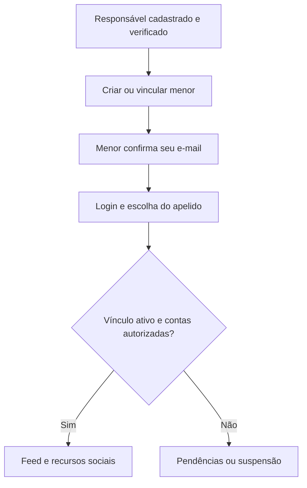
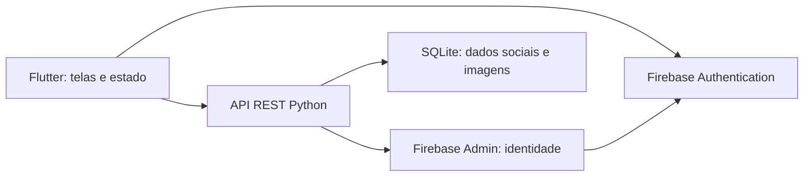

# Conexia Segura - documento consolidado do MVP

**Versão:** 2.0 · **Atualização:** 16/10/2026  
**Autores:** Jean dos Santos Fonseca; Deivison Oliveira Costa; Matheus Zeferino Dias.  
**Desenvolvedor da aplicação:** Jean dos Santos Fonseca. **Orientador:** Marcos Leite.  
**Instituição:** Centro Universitário Jorge Amado (Unijorge), Ciência da Computação, TCC.  
**Situação:** MVP funcional local para web. Recursos escolares, eficácia educacional e prontidão de produção ainda não foram demonstrados.

## 1. Apresentação do projeto

A Conexia Segura integra uma experiência de rede social com participação familiar transparente. Crianças e adolescentes podem publicar, acompanhar conteúdo e conversar dentro das permissões concedidas. Responsáveis possuem contas independentes para gerir vínculos, autorizar conexões e consultar o contexto de publicações exibidas no feed.

A concepção partiu da percepção de Jean dos Santos Fonseca de que não encontrava, em sua experiência, uma aplicação que reunisse a proposta desejada. Essa percepção motivou a criação de um espaço que combine educação, diversão e diálogo. Trata-se da motivação do idealizador, não de evidência de inexistência de soluções semelhantes no mercado.

O uso em um ambiente controlado, como uma escola, é uma direção de aplicação. Conteúdos criativos, leitura, esportes e atividades coletivas poderiam apoiar aprendizagem e pertencimento; a participação familiar poderia contextualizar a experiência digital. Esses benefícios são hipóteses a avaliar, e não resultados obtidos. Perfis de tutor escolar, turmas, instituições e atividades pedagógicas formais ainda não foram implementados.

## 2. Problema e hipótese do MVP

O problema de engenharia consiste em combinar autonomia de interação, autorização familiar, identidade separada e acompanhamento compreensível. O responsável precisa entender o que é compartilhado; o menor deve conhecer o alcance desse acompanhamento.

A hipótese de produto é que um feed com categorias e marcações para conversa pode favorecer diálogo familiar. A validação técnica confirma comportamentos do software em condições testadas; não comprova redução de riscos, aprendizagem, bem-estar ou aproximação entre familiares. Não houve estudo com participantes nem avaliação escolar.

## 3. Usuários e papéis

| Papel | Uso principal | Situação atual |
|---|---|---|
| Criança/adolescente | Feed, perfil, publicação e mensagens | Conta privada; exige confirmações, vínculo ativo, apelido e ausência de suspensão |
| Responsável | Gestão da família e acompanhamento | Cria/vincula o menor, pausa acesso e decide consentimentos de contatos |
| Conta adulta | Participação social | Visibilidade configurável e aceite de conexões |
| Administrador local | Métricas, consulta de contas e denúncias | Autenticado; papel concedido pelo backend; disponível no ambiente de desenvolvimento |
| Tutor escolar | Mediação pedagógica proposta | Planejado; sem conta, permissões ou telas próprias |

Um responsável pode ter vários menores vinculados. O modelo atual associa cada menor a um responsável. Idade é declarada por nascimento; confirmar e-mail não comprova idade, parentesco ou guarda. Transferência de responsável e múltiplos responsáveis exigem regras futuras.

## 4. Cadastro: duas contas e duas confirmações

O responsável cria sua identidade Firebase, confirma o e-mail e entra em Minha família. A seguir, cria ou vincula a conta do menor por uma instância secundária do Firebase, preservando sua sessão. A API valida as identidades e grava o vínculo. O menor confirma seu próprio e-mail, entra com credenciais independentes e escolhe o apelido público.



O acesso exige e-mail do menor confirmado, responsável adulto verificado, vínculo ativo, apelido escolhido e ausência de suspensão relevante. A API verifica as condições; alterar apenas a interface não concede autorização. A suspensão do responsável também impede a liberação familiar do menor.

Falhas na criação ou no envio da confirmação possuem mensagens e tentativa de retomada. O cadastro familiar completo, com entrega e confirmação em duas caixas reais, ainda precisa de roteiro ponta a ponta. As quatro contas de demonstração não substituem esse ensaio.

## 5. Nome, perfil e fotos

O nome interno informado pelo responsável é separado do apelido escolhido pelo menor. O primeiro serve ao painel familiar; o segundo identifica o autor no feed. Perfil inclui biografia e avatar substituível/removível. Tocar no avatar ou nome abre o perfil permitido do autor.

Imagens de perfil, posts e stories são BLOBs no SQLite, vinculados ao proprietário. A API devolve a mídia por rota autenticada e aplica visibilidade; conhecer o identificador não concede acesso. Não há uso de Firestore ou Firebase Storage para os dados sociais.

O pipeline usa Pillow para validar pixels, formato e tamanho, aplicar orientação e recodificar a imagem sem EXIF, GPS e comentários embutidos. Aceita JPEG, PNG e WebP estáticos, até 5 MB, 4.096 pixels por lado e 16 milhões de pixels. Há limite de armazenamento por conta. A normalização não identifica conteúdo inadequado e não equivale a moderação automática.

## 6. Experiência social implementada

| Módulo | Implementado | Limite atual |
|---|---|---|
| Feed | Texto/fotos, categorias, curtidas, comentários e paginação por cursor | Sem recomendação por IA ou pesquisa de posts |
| Publicação | Criar, editar legenda, excluir e carrossel de até 10 fotos | Sem vídeo e edição completa da galeria publicada |
| Stories | Conteúdo com expiração lógica de 24 horas | Exclusão física por manutenção; sem acompanhamento familiar |
| Perfil/pesquisa | Apelido, bio, avatar, publicações e busca de perfis permitidos | Não há diretório irrestrito de menores |
| Contatos | Pedido, aceite, consentimentos familiares, cancelamento e desconexão | Conexões recíprocas, não seguidores unilaterais |
| Mensagens | Texto individual persistido, leitura e paginação | Contato aprovado e preferências de ambos; polling, sem anexos ou push |
| Privacidade | Bloqueios, exportação e exclusão da conta | Exportação ainda não cobre integralmente todos os dados familiares |
| Administração | Indicadores, lista de contas e tratamento de denúncias | Operação local; sem console completo de produção |

### Navegação

A navegação social reúne Feed, Pesquisa, Criar, Mensagens e Perfil. Avatares abrem perfis; cartões abrem comentários; a família e a segurança ficam em jornadas próprias. Navigator e rotas nomeadas coexistem com telas abertas imperativamente. O acesso depende do estado autenticado e das permissões retornadas pela API.

### Prévia local

A prévia debug usa estado em memória e imagens em assets/feed. Serve para explorar aparência e interações sem login, sem gravar no banco ou conceder acesso. É distinta do seed persistente e fica indisponível em release. Favoritos ainda são marcadores da sessão, sem coleção persistente no backend.

## 7. Acompanhamento familiar

### Categorias e histórico

O painel agrupa exibições em Animes, Jogos, Esportes, Música, Educação, Arte e Outros. A categoria é declarada pelo autor, sem classificação por IA. Os filtros abrangem 7 ou 30 dias; a lista mostra até 50 registros recentes.

O cliente registra o post quando ao menos metade do cartão permanece visível por 2 segundos contínuos, com a tela ativa. Há um registro por menor, publicação e dia UTC; nova exibição atualiza o horário. A retenção técnica do histórico é de 30 dias. A API não comprova atenção humana ou a veracidade de um cliente adulterado.

O responsável consulta publicações ainda visíveis para o menor. Exclusão, bloqueio ou restrição podem tornar o conteúdo indisponível. O histórico não mantém cópia antiga da foto ou legenda e não deve ser interpretado como medida de interesse ou de bem-estar.

### Vamos conversar? e transparência

Menor e responsável podem marcar publicações como assunto, concluir como Conversamos e reabrir o tema. O recurso produz notificações internas e evita marcações abertas duplicadas. As últimas 50 marcações são apresentadas; não seguem automaticamente a expiração do histórico.

O menor acessa O que meu responsável vê, com o mesmo contexto familiar. O acompanhamento não inclui conversas privadas, stories nem navegação em outros aplicativos. A proposta de aproximação familiar depende de avaliação posterior com usuários.

## 8. Arquitetura e tecnologias



| Camada | Tecnologia | Responsabilidade |
|---|---|---|
| Interface | Flutter/Dart, Material 3, Lato e ícones Lucide | Telas, componentes responsivos e feedback |
| Estado | AppState/ChangeNotifier e AppScope | Sessão e conta; estado local nas telas |
| Dados do cliente | ApiClient e repositórios | HTTP, erros, renovação e modelos |
| Identidade | Firebase Authentication e Admin SDK | Credenciais, tokens e verificação no servidor |
| Backend | Python, ThreadingHTTPServer e serviços | Regras por recurso e autorização |
| Persistência | SQLite, WAL, chaves estrangeiras e transações | Integridade de dados sociais e BLOBs |

A divisão de responsabilidades se alinha à orientação geral de separação entre interface e dados do Flutter (FLUTTER, s.d.), mas a aplicação não implementa integralmente uma arquitetura MVVM por funcionalidade. AppState concentra sessão; várias telas ainda coordenam carregamento e estado local.

O SDK Firebase fornece o ID token; a API o valida com verificação de revogação (GOOGLE, s.d.). Não há mesclagem automática por e-mail. Rotas legadas permanecem para compatibilidade e testes. O servidor é de desenvolvimento, não uma infraestrutura pública de produção.

## 9. Organização do código

```text
teste_app/
+-- lib/main.dart              Inicialização e navegação
+-- lib/core/                 Cliente HTTP
+-- lib/models/               Contratos e modelos
+-- lib/repositories/         Integrações e dados
+-- lib/state/                Sessão e prévia
+-- lib/screens/              Família, social e Admin
+-- lib/widgets/              Componentes e exibição
+-- lib/theme/                Tema e tokens visuais
+-- backend/                  API, regras e SQLite
+-- backend/fixtures/         Catálogo e manifesto QA
+-- test/                     Testes Flutter
+-- docs/                     Documentação do produto
```

O backend separa serviço principal, contatos, supervisão familiar, administração, imagens, paginação e idempotência. O repositório centraliza conexão e transações; parte das consultas permanece nos serviços. Migração para outro banco exige adaptar SQL e definir migrações versionadas.

## 10. Modelo de dados

| Grupo | Tabelas | Finalidade |
|---|---|---|
| Identidade | users, firebase_identities | Perfil e vínculo com UID Firebase |
| Papéis/situação | administrators, account_status | Papel local de Admin e suspensão |
| Família | guardian_links | Responsável, nome interno, apelido e estado |
| Contatos | contacts, contact_requests, contact_consents | Rede recíproca, aceite e autorizações |
| Conteúdo | posts, post_categories, post_media | Posts/stories, classificação e carrossel |
| Mídia | media, profile_media, media_created | BLOB, avatar e idade do upload |
| Interações | likes, comments, messages | Curtidas, comentários e mensagens |
| Acompanhamento | feed_views, family_discussions | Exibições e assuntos familiares |
| Segurança | blocks, reports, notifications, audit | Bloqueios, denúncias e eventos |
| Consistência | mutation_receipts, identity_deletions | Repetição segura e exclusão Firebase |
| QA/compatibilidade | seed_runs, sessions, challenges | Cargas fictícias e autenticação anterior |

Chaves estrangeiras e cascatas preservam relações. Ao excluir posts, referências do acompanhamento podem ficar nulas. WAL e synchronous=FULL, bloqueio por RLock e savepoints apoiam consistência no processo atual; não eliminam o limite de concorrência de escrita do SQLite (SQLITE, s.d.).

## 11. Segurança, consistência e ciclo de vida

O cliente usa versões de sessão para descartar respostas antigas, serializa operações de identidade e evita renovações concorrentes. Logout ou perda de autorização remove a navegação privada. Retomada do aplicativo atualiza permissões; timers e subscriptions são tratados no ciclo de vida. Telas têm estados de falha e nova tentativa.

Na API, validações e consultas parametrizadas complementam autenticação, autorização por recurso, CORS de origens exatas e restrição a loopback. Bloqueios interrompem conexões em ambas as direções; desbloquear não restaura aprovações. Uma denúncia não suspende automaticamente o usuário.

Operações de criação compatíveis aceitam chave de idempotência. O recibo é persistido na transação por 24 horas: repetir a mesma operação pode devolver o resultado anterior; reutilizar a chave com outro conteúdo gera conflito. Isso reduz duplicação, sem prometer execução única para toda a API.

Exclusão de conta Firebase exige autenticação recente. Uma fila persistente registra exclusões externas e permite novas tentativas após falha do provedor. Exportação inclui perfil, conteúdo, interações, pedidos e consentimentos; mídia sai como metadados, não como pacote binário completo. Dados familiares e alcance da exportação ainda exigem revisão.

Backups usam a API de backup do SQLite e verificam integridade. Manutenção remove conteúdo expirado, sessões, recibos e mídias órfãs com carência de 24 horas. Credenciais Admin e senhas de demonstração ficam fora da documentação e do app. Não se declara auditoria externa, conformidade certificada, prova de idade ou moderação automática.

## 12. Estado real e limitações

A versão entrega o núcleo familiar/social, mídia normalizada e administração local. Testes de regressão verificam sessão, paginação e consistência.

Permanecem pendentes: confirmação em dois e-mails reais; Android/iOS; servidor de produção, HTTPS, monitoramento e migrações; carga e restauração; acessibilidade com participantes; operação de atendimento; exportação ampliada e transferência de vínculo.

Vídeos, anexos no chat, push, WebSocket, favoritos persistentes, pesquisa de posts e módulos escolares permanecem futuros. A criação de logins Firebase para os 120 perfis foi adiada.

## 13. Evidências de qualidade

Em 16/10/2026, a revisão documental repetiu os testes automatizados do projeto. O build web mais recente verificado foi concluído em 15/10/2026; houve aviso não impeditivo sobre fonte Cupertino. Compilação não comprova operação em produção.

| Verificação | Evidência |
|---|---|
| Backend Python | 101 testes aprovados |
| Flutter | 49 testes aprovados |
| Análise estática Flutter | Sem problemas encontrados |
| Build web | Concluído em 15/10/2026 |
| Integração local | Login Firebase, Admin, feeds e chats verificados em 15/10/2026 |
| SQLite | Integridade OK e nenhuma violação de chave estrangeira na carga verificada |

Os testes cobrem permissões, sessão, contatos/consentimentos, mídia, exclusão, idempotência, navegação, layout, respostas tardias e seed. Verificadores simulados permitem cenários negativos; verificações locais com quatro logins Firebase complementam esses testes. Não houve benchmark de concorrência nem pesquisa com menores.

## 14. Execução local

Primeiro terminal do VS Code, na pasta do projeto:

```powershell
cd C:\Users\Pc\Downloads\teste\teste_app
python -m pip install -r backend/requirements.txt
.\backend\start_firebase.cmd
```

Segundo terminal:

```powershell
cd C:\Users\Pc\Downloads\teste\teste_app
flutter pub get
flutter run -d chrome --web-port 5300 `
  --dart-define=API_URL=http://127.0.0.1:8080
```

O acento grave ao final da linha é a continuação do PowerShell; alternativamente execute flutter run e os parâmetros em uma só linha. A API usa a porta 8080 e a interface usa 5300. Não inicie uma segunda API se a primeira já estiver ativa. A credencial privada é configurada no launcher fora do repositório; fazer login na CLI Firebase não substitui a credencial Admin.

```powershell
python -m unittest discover -s backend -p "test_*.py"
flutter analyze
flutter test
```

## 15. Plano de evolução para piloto

### Prioridade 1 - fechar a verificação ponta a ponta

Executar criação familiar com duas caixas de e-mail controladas, confirmação real, apelido, consentimento, mensagens e acompanhamento; testar recuperação, exclusão e falhas do provedor. Critério: jornada completa reproduzida sem edição manual de autorização no banco.

### Prioridade 2 - preparar operação

Separar ambientes, adotar servidor e banco adequados ao volume previsto, HTTPS, migrações e observabilidade; ensaiar restauração e definir atendimento de denúncias, retenção e revisão de dados. A interface Admin existente é base local, não conclusão dessas atividades.

### Prioridade 3 - avaliar experiência e extensão escolar

Avaliar acessibilidade, compreensão familiar e usabilidade com protocolo definido. Um piloto escolar dependerá de regras institucionais, papéis de tutor, isolamento por instituição/turma e responsabilidades de acesso. Esses requisitos devem preceder o uso com participantes.

## 16. Métricas de produto propostas

| Pergunta | Indicador a avaliar |
|---|---|
| Cadastro pode ser concluído? | Conclusão por etapa das duas confirmações e vínculo |
| Acompanhamento é compreendido? | Testes de compreensão com ambos os perfis |
| Há apoio ao diálogo? | Assuntos concluídos, complementados por entrevistas |
| Operação responde? | Prazo e resultado da análise de denúncias |
| Experiência é estável? | Erros, latência e lacunas de exibição |
| Educação e diversão se articulam? | Avaliação de atividades em futuro piloto escolar |

Indicadores de eficácia e funil permanecem propostos. Os contadores Admin descrevem o banco, sem demonstrar resultados educacionais ou participação real.

## 17. Roteiro de demonstração

1. Apresentar a prévia debug e explicar seu estado descartável.
2. Entrar nas contas de demonstração existentes, sem divulgar senhas na apresentação.
3. Mostrar feed, perfis, avatares, carrosséis, comentários e stories ativos.
4. Mostrar pedidos de contato e consentimentos da família de teste.
5. Abrir conversas autorizadas e verificar histórico e leitura.
6. Comparar acompanhamento do menor e do responsável; marcar Vamos conversar?.
7. Demonstrar pausa do vínculo, bloqueio e restrição de conteúdo.
8. Entrar como Admin e conferir métricas, filtros e denúncias.
9. Identificar dados sintéticos e diferenciar métricas técnicas de evidência de eficácia.
10. Apresentar pendências e proposta de avaliação escolar futura.

## 18. Documentação e rastreabilidade

Fontes internas: código em lib/ e backend/, testes em test/ e backend/test_*.py, docs/API.md, docs/FIREBASE.md e docs/ACOMPANHAMENTO_FAMILIAR.md. Relatórios anteriores preservam a história, mas suas contagens e pendências não substituem esta versão consolidada.

O PDF acadêmico atualizado acompanha este MVP. A formatação adota estrutura de trabalho acadêmico; a adequação ao manual específico da instituição e a revisão final pelo orientador ainda precisam ser confirmadas. Não foram inventados pesquisa de campo, aprovação ética, resultados de aprendizagem ou contribuições individuais dos novos autores.

## 19. Administração e moderação local

O papel é concedido em administrators no backend, sem autopromoção pelo cliente. O acesso exige identidade autenticada, conta adulta ativa e ambiente de desenvolvimento. A tela de administração consulta indicadores e uma lista paginada de 30 contas, filtrável por todas, ativas/verificadas, suspensas ou não verificadas.

Os indicadores incluem usuários, posts, vínculos, denúncias pendentes, contas suspensas, não verificadas e denunciadas, administradores, conexões, pedidos pendentes, mensagens, não lidas, comentários, curtidas, stories ativos/expirados, bytes de mídia e exibições. A API também agrega posts por categoria; nem toda agregação tem gráfico próprio na interface.

Denúncias podem ser arquivadas; posts e comentários denunciados podem ser removidos com confirmação. Alvos de perfil/conversa exigem investigação manual. A lista não possui fluxo geral de suspender/reativar; o seed cria situações para QA e a API restringe o uso das contas suspensas. Administração não recebe autorização geral para ler mensagens privadas.

## 20. Base sintética de QA e testes de volume

O seed reproduzível usa o schema real e namespace qa-demo-v1. A primeira carga gerou 120 perfis, 2.400 posts, 360 stories e 18.000 mensagens. A inclusão posterior de duas fotos elevou o total de posts do seed para 2.402. Nove imagens fornecidas integram avatares/publicações; as demais usam placeholders locais variados.

| Entidade do seed | Quantidade registrada |
|---|---|
| Perfis fictícios | 120 |
| Posts / stories | 2.402 / 360 |
| Mensagens | 18.000 |
| Conexões aprovadas | 923 |
| Curtidas / comentários | 12.987 / 3.299 |
| Denúncias | 304 |
| Exibições / assuntos familiares | 2.994 / 131 |
| Mídias / fotos fornecidas | 1.230 / 9 |
| Contas suspensas / não verificadas | 7 / 9 |

As contagens descrevem a carga registrada, não o total imutável do banco: contas e conteúdo anteriores foram preservados, e interações posteriores alteram totais. Stories expiram com o tempo; manutenção pode removê-los. Denunciado e suspenso são situações independentes, com possível sobreposição.

Os 120 perfis existem no SQLite, mas não possuem senha conhecida nem identidade Firebase. Há quatro logins de demonstração separados: Admin, teste, responsável e jovem, conectados à rede sintética. Suas credenciais ficam em arquivo privado externo. A criação de logins para os demais foi adiada por decisão do projeto.

Conversas têm participantes autorizados, diálogos alternados, horários variados e itens lidos/não lidos. A rede inclui pedidos pendentes, bloqueios e consentimentos sintéticos. São cenários técnicos; não comprovam consentimento real, uso espontâneo ou capacidade sob acesso simultâneo.

```powershell
$env:CONEXIA_DEV='1'
python backend/seed_data.py --connect-demo-accounts
```

O padrão configura 120 usuários, 2.400 posts, 360 stories e 18.000 mensagens. O namespace já registrado é preservado ao repetir. Parâmetros --users, --posts, --stories e --messages ajustam uma nova carga. --reset recria somente registros desse namespace, após backup, e não deve ser usado para apenas atualizar o feed.

O catálogo e o manifesto em backend/fixtures registram fotos e contagens. append_seed_photos.py inclui novas fotos sem recriar a base.

## 21. Refinamento visual e estabilidade da interface

A interface usa tipografia Lato empacotada, Material 3, ícones Lucide e tokens de cor, espaçamento e movimento. A paleta combina índigo #4D5BD5, texto #1C2940 e fundo #F5F7FB, com superfícies claras, bordas discretas e sombras suaves. Login, cartões, painéis e formulários compartilham componentes de marca e superfície.

Skeletons, erros recuperáveis, estados vazios e indicadores de envio dão feedback. Há proteção contra toques repetidos e respeito à redução de animações. Testes abrangem texto ampliado, telas pequenas, logout, respostas tardias e falhas de mídia.

Acessibilidade com tecnologias assistivas e dispositivos reais ainda precisa de avaliação. Os testes não certificam acessibilidade ou ausência de defeitos.
